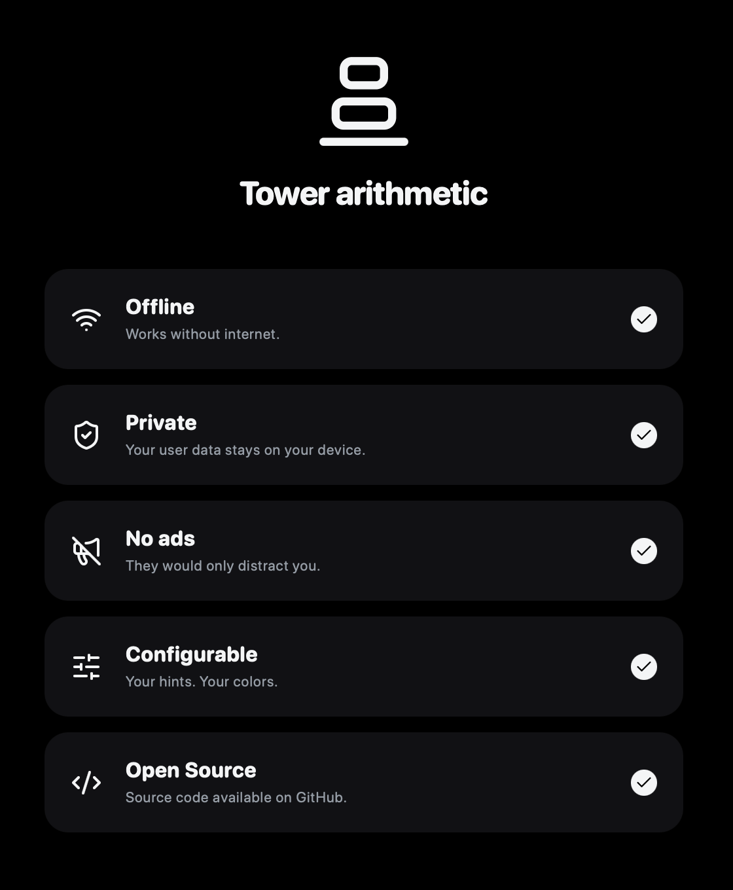
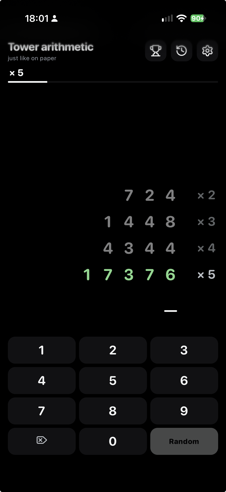

# Turmrechner

Practice written multiplication and division in an arithmetic tower. Choose when answers are checked,
review mistakes, and track your times. Turmrechner is an installable web app in German and English.
It stores games locally and works offline after its first complete load.

The visual design is heavily inspired by Trade Republic's clean monochrome aesthetic.

[Open Turmrechner](https://turmrechner.com/?ref=github)

<p align="center">
  
  
</p>

## Get started

Open the app, choose your preferences, and enter a starting number or generate one at random.
Use the on-screen keypad or your keyboard to solve the tower.

- Easy blocks incorrect inputs. Normal corrects mistakes after each row and locks checked rows.
  Hard checks the completed tower and allows deleting back into earlier rows.
- Calculation previews, carries and remainders, and the visible timer are optional.
- Run history stores your starting number, time, mistakes, and settings on your device.
- Nine achievements celebrate your progress. Open the trophy to see your collection and share unlocked achievements.
- Native sharing creates an image of your results with a link to the app.

The app works offline after its first complete load. On iPhone, use Safari's **Add to Home Screen**
to install it. On iPhone and iPad, onboarding includes an installation guide directly after the introduction.

On mobile, the app stays in a playable portrait frame even when the device is held horizontally.
The installed app requests a portrait lock; browsers that ignore it use a counter-rotated portrait frame.

No account is needed. Game data stays in your browser, with no sync between devices.
Clearing website data also deletes saved runs and achievements. See [app behavior and privacy](docs/app.md) for details.

## Stack

### App

[](https://vuejs.org/)
[](https://www.typescriptlang.org/)
[](https://vite.dev/)
[](https://vite-pwa-org.netlify.app/)
[](https://developer.chrome.com/docs/workbox/)
[](https://lucide.dev/)

### Development

[](https://nodejs.org/)
[](https://pnpm.io/)
[](https://vitest.dev/)
[](https://test-utils.vuejs.org/)
[](https://github.com/capricorn86/happy-dom)
[](https://eslint.org/)
[](https://prettier.io/)

### Deployment

[](https://github.com/MartinReisinger/turmrechner/actions)
[](https://www.docker.com/)
[](https://busybox.net/)
[](https://caddyserver.com/)

## Develop locally

Use Node.js 24 and pnpm 11.6.0, as recorded in [package.json](package.json).

```bash
pnpm install --frozen-lockfile
pnpm run dev --port 3000 --strictPort
```

Open http://127.0.0.1:3000. To run lint, tests, TypeScript checks, and the production build:

```bash
pnpm verify
```

See the [development guide](docs/development.md) for code organization, offline previews, icon generation,
and GitHub Actions deployment.

## Help and contributions

Report bugs and suggest improvements in the [issue tracker](https://github.com/MartinReisinger/turmrechner/issues).
For bugs, include reproduction steps, your device and browser, and the selected game mode.

Martin Reisinger maintains this project. For contributions, keep changes focused, run `pnpm verify`,
and describe the resulting behavior in your pull request.

## License

[](LICENSE)

Copyright 2026 Martin Reisinger.
[Third-party notices](THIRD_PARTY_NOTICES.md) cover the Lucide icons.
